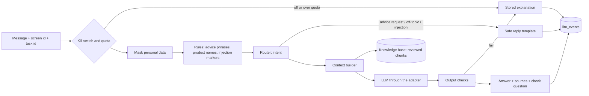

# backend/ml: the tutor agent

Owner: Mateusz.

Readers:
- the backend (Mohamed), who calls `POST /tutor`;
- the frontend (Michał), who shows the tutor bubble;
- anyone reviewing safety.

Status: architecture only, no code yet. Draft on branch `skills-tree`,
2026-11-20.

## Role

The tutor explains. It does not answer for the user, and it does not give
investment advice. It is the inclusive part of the app: it rephrases a task
in simpler words, at a slower pace, or with another example for anyone who
gets stuck.

**Why a guarded tutor and not a free chatbot.**
- Bastani et al. 2025, *PNAS* 122(26): in a field experiment, students with
  unguarded GPT-4 practised better but scored 17% worse on the exam without
  it. A guarded "GPT Tutor" did not harm the exam.
- Kestin, Miller et al. 2025, *Scientific Reports* 15:17458: a tutor built on
  learning-science principles more than doubled learning gains compared with
  an active-learning lesson.

Read both papers before quoting the numbers in the pitch.

Content is written by people. The model does not write tasks or answers. It
may only reword an explanation that a person or the engine produced.

## When the tutor runs

| Trigger | What it does |
|---|---|
| The user taps "Zapytaj tutora" on a card or task | Explains the concept or the task in other words |
| Before the user submits a medium or hard task | Hint ladder only: (1) the concept, (2) a worked example with other numbers, (3) which reason to think about. Each hint lowers the task score (proposal: 10% per hint) |
| After the user submits | Explains the reveal: why the true value is what it is, and why each picked box was weighted that way |
| The recommender flags struggle: two failed attempts on a node, or predicted success below 0.4 | Offers one card to repeat and 1-2 readings from the knowledge base for that node |

## Pipeline

One model call per message. There is no autonomous loop: the backend fetches
everything before the call.



**Router intents:**
- `explain_concept`;
- `explain_task`;
- `hint`;
- `explain_result`;
- `recommend_reading`;
- `advice_request` ("which fund should I buy?"): answered by the safe
  template, which explains how to compare products and points to O2;
- `off_topic`;
- `injection`.

The first version is rules plus a small model with a JSON schema.

**Context builder.** The model sees only:
- the screen and task text, without truth values before submission;
- the user's response;
- the reveal JSON, after submission only;
- profile aggregates: age band, goal, horizon, mastery per node and the
  calibration gap. It never sees raw income or the user's name;
- the top 3 knowledge-base chunks for the node and the question.

**Output checks.** If any check fails, the stored explanation is shown
instead.
1. Every number in the answer appears in the context. The model may not
   invent numbers.
2. No product names, tickers or ISINs, and no "buy" or "sell"
   recommendations.
3. Before submission: no truth value and no box weight leaks.
4. Every cited source ID exists in the context.
5. At most about 200 words, plain English, ending with one check question.
   The tutor answers in English even if the user writes in Polish (a
   Polish version comes later).

## Knowledge base

- **Source:** the source register in `docs/skills_tree.md`.
- **What the tutor may quote:** only tier A sources whose reuse terms a
  person has confirmed. Tier B sources appear only as "further reading"
  links.
- **Chunk record:**
  `chunk_id, node, source_id, url, retrieved, licence, reviewed_by,
  valid_until`.
- **Expired chunks** (`valid_until` passed) are not retrieved.
- **Retrieval:** BM25 over SQLite FTS5. This is enough for a few hundred
  chunks and is deterministic. Embeddings come later if recall is too low.
- **Later:**
  - materials written by our own experts (tier A by default);
  - curated news, each item flagged with its date and never used for
    numbers.

## Tools (read-only, called by the backend, not by the model)

- `get_screen_context(screen_id)`
- `get_task_public(task_id)`
- `get_attempt_result(attempt_id)`: available after submission only.
- `get_learner_profile(user_id)`: aggregates only.
- `search_kb(node, query)`
- `recommend_reading(node)`: 1-2 links from the knowledge base.

## Models: modular and local-first

- **One adapter.** Code calls roles, never model names: `router`,
  `tutor_small`, `tutor_large`.
- **Config maps each role to a provider:**
  - Ollama or llama.cpp locally;
  - Vertex AI (the `.env.example` already names `VERTEX_AI_REGION`).
- **LiteLLM SDK** gives one interface, fallbacks and switching by config.
- **Data rule.** A request flagged `contains_user_data` never goes to a
  cloud role. Cloud is allowed only for general concept questions with no
  profile data.
- **Candidates, to measure, none chosen yet:**
  - Bielik 4.5B or 1.5B v3 (Polish; for the later Polish version);
  - Qwen3.5 4B / 9B;
  - Gemma 4 12B.
- **Choice rule:**
  - 20 English tutor prompts from our demo tasks;
  - pick the smallest model that passes the output checks on at least
    18/20 and answers within about 10 s on the demo laptop;
  - otherwise, use stored answers for the demo script.

## Monitoring and the admin panel

The admin panel is shared with the recommender.

`llm_events` row:

```
event_id, ts, user_pseudo_id, screen_id, task_id, node, intent, model_role,
model_version, prompt_version, latency_ms, tokens_in, tokens_out,
checks_failed [list], fallback_used, user_rating (thumbs), flagged_for_review
```

Raw text is masked and kept for 30 days, only for answers flagged for
review.

**Panel views.**
- **Advice watch:**
  - share of `advice_request` intents;
  - output-check failures by type;
  - a queue of flagged answers for a person to review.
- **Quality:**
  - thumbs down;
  - fallback rate;
  - latency;
  - cost per day.
- **Learning effect:** score and confidence on tasks after a tutor session,
  compared with tasks without one (descriptive only, not causal).
- **Recommender:**
  - struggle flags per node;
  - accepted vs ignored recommendations;
  - calibration gap per node.

**Kill switches:**
- `TUTOR_ENABLED`;
- `MODEL_ALLOWLIST`;
- `CLOUD_ROLES_ENABLED`;
- `DAILY_BUDGET`, which trips the kill switch automatically;
- `PROMPT_VERSION`;
- `USER_BLOCK`.

## Quota

- A daily message quota per user.
- The weekly streak and completed nodes add quota.
- Stored explanations do not count.

## API

`POST /tutor`

```json
{"screen_id": "task", "task_id": "f4.m1", "attempt_id": null, "mode": "hint", "message": "I do not get where the fee comes from"}
```

```json
{"text": "...", "sources": ["uokik_portal"], "check_question": "...", "hint_level": 1, "fallback": false}
```

## Tests (every change, per the repo rule)

1. A red-team set of about 50 Polish and English prompts against the rules
   and the router: advice extraction, injection, asking for the answer.
   Expected: the safe template or a hint, never the answer.
2. **Output checks.**
   - Each check has a passing and a failing example written by hand. For
     example, an answer with a number that is not in the context must fail
     the number check.
   - These test the checks themselves, not the model.
3. **The 20-prompt model choice set** above. Run when the model or prompt
   version changes, not in CI.

## Scope for the 48 hours

- **In:**
  - rules;
  - router;
  - context builder;
  - one local model;
  - output checks 1-3;
  - the stored-explanation fallback;
  - `llm_events`;
  - one admin view (advice watch);
  - the kill switches.
- **Later:**
  - embeddings;
  - news;
  - expert materials;
  - learning-effect view;
  - a model fine-tuned on reviewed explanations.
