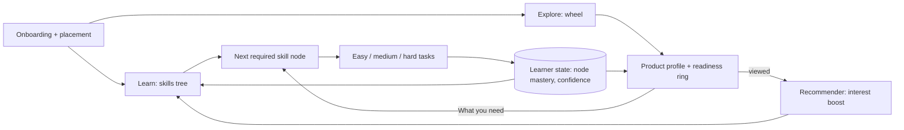

# Skills tree: panels, inputs, outcomes, syllabus, task ideas

Readers:
- content authors: cards and questions;
- frontend: tree screen and the Explore wheel;
- backend: unlocks and prerequisite tests;
- Yurii: the block engine and the medium tasks.

Purpose: agree what the learning path contains before we write content.
Status: draft for review on branch `skills-tree`, 2026-11-20.

The task ideas are proposals: one medium and one hard idea for every node.
We build only a few for the demo. The rest show that the format scales to the
whole tree.

## Decisions this rests on (team, 2026-11-20)

- The **skills tree** is the learning path and drives recommendations.
- The **product wheel** (13 investment types, today's `roadmap.json`) becomes
  the **Explore** catalogue. Each product points to the nodes it needs (table
  at the end).
- Market data comes only from public sources, with the source and licence
  recorded per series.
- Confidence is asked on every scored item.
- The UI language is English. Polish instrument names (IKE, IKZE, PPK, KNF)
  stay, each with an English explanation. Amounts are in PLN.
- The demo shows two personas: a young adult and a self-directed investor.
  Paths are in [onboarding_router.md](onboarding_router.md).
- Medium tasks use real public data. Licences are checked by a person before
  use (checklist in [task_engines.md](task_engines.md)).
- Yurii builds the block ("Scratch-like") engine for hard tasks. Free play
  (sandbox) is postponed.

## Node structure

Every node has, in this order:

1. **Prerequisite test.**
   - 2-3 items drawn from the check questions of the node's prerequisite
     nodes.
   - Passing it skips the easy items.
   - The first item also checks whether routing placed the user correctly.
2. **Easy:** theory items plus learning cards (a few sentences, an example
   in PLN, 1-2 verified links).
3. **Medium: "estimate and explain".**
   1. The user gets simple data: a chart, a small table or an offer. It
      comes from a public source or from a written persona.
   2. They give an estimate, either a number (a slider or a point dragged on
      the chart) or a direction (rise or fall).
   3. They rate their confidence (1-5).
   4. They pick 2-3 reason boxes out of 6-8.
   5. The reveal shows the true value or outcome and an explanation under
      each box.

   "Day X" is a variant: the chart stops on day X and shows only what was
   known then.
4. **Hard: a block-engine task.**
   - Blocks compile into a strategy.
   - Obligatory tests check the skill. Passing all of them gives 51 points.
   - Optional tests are events weighted by their probability and add up to
     49 more.
   - Scores are shown in a histogram of all users. Baseline bots fill it
     before there are users.

**Medium scoring (0-1).** Proposed:

- **Estimate part.** Used when the true value can be computed (loan cost,
  compound growth, tax).
  - It scores 1 within a tolerance band set by the author, for example ±10%.
  - The score falls linearly to 0 at three times the band.
  - Day-X predictions have no estimate part, because the outcome is not
    known from the information on day X.
- **Reasons part.**
  - The author gives each box a weight from -1 to 1:
    - relevant on day X: positive;
    - irrelevant: 0;
    - wrong or hindsight: negative.
  - Score = the sum of the weights the user picked, divided by the best
    possible sum for the same number of boxes, clipped to 0-1.
- **Task score** = 0.5 × estimate + 0.5 × reasons. When there is no
  estimate part, the reasons part is the whole score.
- Confidence is not scored. It feeds calibration: confidence vs score per
  user and per task.

## Entry assumptions for every user

The app assumes only:
- reading a short text in English;
- adding and subtracting amounts in PLN;
- "10% of 1,000 PLN".

Everything else is taught. No formulas outside the "for the curious"
editorial.

## Panels

Seven panels. DECISIONS holds the "day X" tasks and the behaviour topics a
self-directed investor needs. Macro news (old O4) moved into it as D3.

| # | Panel | Question it answers | EU/OECD-INFE area | Nodes |
|---|---|---|---|---|
| 1 | FOUNDATIONS | How does money work over time? | Money and transactions | F1-F4 |
| 2 | SAFETY | Am I protected before I invest? | Planning and managing finances | S1-S4 |
| 3 | INSTRUMENTS | What am I buying, and what can go wrong? | Risk and reward | I1-I7 |
| 4 | PORTFOLIO | How do I combine instruments? | Risk and reward | P1-P5 |
| 5 | DECISIONS | How do I decide on day X, with what I know then? | Risk and reward; financial landscape | D1-D5 |
| 6 | LONG HORIZON | How do retirement and a mortgage change the plan? | Planning and managing finances | L1-L3 |
| 7 | PROTECTION | Who is on my side, and who is not? | Financial landscape | O1-O4 |

Typical entry nodes by life stage. The actual first path is computed by the
router from the survey ([onboarding_router.md](onboarding_router.md)).

| Life stage | Entry nodes |
|---|---|
| Teenager / student | F1, F2, F4, O1, D4 |
| Young adult, first job | S1, I1, P3, L1 |
| Self-directed investor, already investing | I4, D1, D4, P1 |
| Parent with a mortgage | L2, S3, P2 |
| Pre-retiree / retiree | L3, I2, O1 |

```mermaid
flowchart TD
    subgraph FOUNDATIONS
        F1["F1 Budget and cash flow [E]"]
        F2["F2 Inflation and real value [E]"]
        F3["F3 Compound interest [E]"]
        F4["F4 Cost of credit [M]"]
    end
    subgraph SAFETY
        S1["S1 Emergency fund [E]"]
        S2["S2 Pay off debt or invest [M]"]
        S3["S3 Insurance [M]"]
        S4["S4 Goals and horizon [M]"]
    end
    subgraph INSTRUMENTS
        I1["I1 Risk as a spread of outcomes [E]"]
        I2["I2 Deposits and retail bonds [M]"]
        I3["I3 Bond prices and rates [H]"]
        I4["I4 One stock vs an index [M]"]
        I5["I5 Funds, ETFs, costs, the KID [M]"]
        I6["I6 Currency risk [M]"]
        I7["I7 Leverage: options, futures, CFDs [H]"]
    end
    subgraph PORTFOLIO
        P1["P1 Diversification and correlation [M]"]
        P2["P2 Allocation by horizon [M]"]
        P3["P3 Lump sum vs instalments [M]"]
        P4["P4 Rebalancing in a crash [H]"]
        P5["P5 When correlations break, 2022 [H]"]
    end
    subgraph DECISIONS
        D1["D1 What moves a price [E]"]
        D2["D2 Reading a company's numbers [M]"]
        D3["D3 Macro news: CPI, rate decisions [M]"]
        D4["D4 Biases: FOMO, loss aversion, overconfidence [E]"]
        D5["D5 Decision vs outcome [M]"]
    end
    subgraph LONG_HORIZON["LONG HORIZON"]
        L1["L1 PPK, IKE, IKZE [M]"]
        L2["L2 Mortgage: fixed or variable [H]"]
        L3["L3 Withdrawals, sequence risk [H]"]
    end
    subgraph PROTECTION
        O1["O1 Scams and the KNF register [E]"]
        O2["O2 Information and advisers [E]"]
        O3["O3 Tax on investment income [M]"]
        O4["O4 Guarantees and complaints [E]"]
    end

    F1 --> F2
    F1 --> F3
    F3 --> F4
    F1 --> S1
    S1 --> S2
    F4 --> S2
    S1 --> S3
    F3 --> S4
    F3 --> I1
    I1 --> I2
    F2 --> I2
    I2 --> I3
    I1 --> I4
    I4 --> I5
    F3 --> I5
    I1 --> I6
    I4 --> I7
    I2 --> P1
    I4 --> P1
    P1 --> P2
    S4 --> P2
    I1 --> P3
    P2 --> P4
    P1 --> P5
    I3 --> P5
    I4 --> D1
    D1 --> D2
    F2 --> D3
    I1 --> D5
    D4 --> D5
    F3 --> L1
    S4 --> L1
    F4 --> L2
    I1 --> L2
    P2 --> L3
    I5 --> O3
    O2 --> O4

    classDef easy fill:#d4edda,stroke:#2e7d32,color:#000
    classDef medium fill:#fff3cd,stroke:#b8860b,color:#000
    classDef hard fill:#f8d7da,stroke:#b71c1c,color:#000
    class F1,F2,F3,S1,I1,D1,D4,O1,O2,O4 easy
    class F4,S2,S3,S4,I2,I4,I5,I6,P1,P2,P3,D2,D3,D5,L1,O3 medium
    class I3,I7,P4,P5,L2,L3 hard
```



O1, O2 and D4 are open from the start. [E]/[M]/[H] is the node's overall
difficulty. Every node has easy, medium and hard items.

---

## 1. FOUNDATIONS

**Input.** Only the entry assumptions. No prerequisite test for F1.

**Outcomes.**

| Node | The learner can … |
|---|---|
| F1 Budget and cash flow | list monthly income and costs, find the surplus, spread annual costs per month |
| F2 Inflation and real value | say what money buys after a year of inflation; compare a deposit rate with CPI |
| F3 Compound interest | estimate savings after n years; see why starting early matters |
| F4 Cost of credit | compare loans by RRSO and total amount payable; see the cost of a card balance and BNPL |

**Tasks.**

| Node | Medium: data → estimate → reasons | Hard: blocks → obligatory tests → optional events |
|---|---|---|
| F1 | A persona's daily account balance for 3 months. Estimate the surplus at the end of month 4. Reasons: annual costs, subscriptions, payday timing. Typical amounts from GUS household budgets. | A payday rule: fixed costs → savings X% → envelope for annual costs → the rest. Obligatory: no overdraft in a normal year. Optional: car repair, 10% price rise, Christmas, a new child. |
| F2 | GUS CPI and the NBP rate for 2019-2024 on one chart. Estimate what 10,000 PLN on a 3% deposit was worth in real terms after 2021-2023. The answer is computed from CPI. | A yearly choice between cash, deposit and inflation-indexed bond. Obligatory: real value of at least 95% after 5 years on the base path. Optional: the 2022 inflation path, rate cuts. |
| F3 | Play with the chart: drag the end of the line to guess the value of 500 PLN a month at 5% after 30 years. The reveal splits the result into contributions and interest. | A saving rule: amount, yearly rise with inflation, start age. Obligatory: reach the goal by 60 on the median path. Optional: start 5 years later, lower returns, a 2-year pause. |
| F4 | A loan offer: 20,000 PLN over 36 months with a nominal rate, a fee and insurance. Estimate the total amount payable, and pick the cheaper of two offers. Reasons: the fee counts, insurance, the term, RRSO vs the nominal rate. The answer is computed. | A repayment plan for a card, a cash loan and BNPL, for example "minimums on all, extra to the highest RRSO". Obligatory: all debt repaid within 36 months, no missed minimum. Optional: income drop, a BNPL late fee, an unexpected cost. |

**Syllabus.**

| Source | Read for | Tier | Link check |
|---|---|---|---|
| [EC / OECD-INFE adult framework (2022)](https://finance.ec.europa.eu/publications/commission-and-oecd-infe-publish-joint-framework-adults-improve-individuals-financial-skills_en) | competences to cite on each card | A (confirm) | ok |
| [GUS consumer price indices](https://stat.gov.pl/obszary-tematyczne/ceny-handel/wskazniki-cen/wskazniki-cen-towarow-i-uslug-konsumpcyjnych-pot-inflacja-/) | F2: what CPI measures, monthly prints | A (confirm) | ok |
| [GUS incomes, expenditure and living conditions](https://stat.gov.pl/obszary-tematyczne/warunki-zycia/dochody-wydatki-i-warunki-zycia-ludnosci/) | F1: realistic persona budgets | A (confirm) | ok |
| [ECB: What is inflation?](https://www.ecb.europa.eu/ecb-and-you/explainers/tell-me-more/html/what_is_inflation.en.html) | F2: plain-language explanation | A (confirm) | ok |
| [NBP basic interest rates](https://nbp.pl/polityka-pieniezna/decyzje-rpp/podstawowe-stopy-procentowe-nbp/) | F2: rates vs inflation | A (confirm) | ok |
| [Investor.gov compound interest calculator](https://www.investor.gov/financial-tools-calculators/calculators/compound-interest-calculator) | F3: worked examples | A (US federal; confirm) | ok |
| [UOKiK consumer rights portal](https://prawakonsumenta.uokik.gov.pl/) | F4: consumer credit, RRSO, pre-contract information | A (confirm) | ok |
| [Financial Ombudsman, education](https://rf.gov.pl/edukacja/) | F1, F4: guides on loans and payday loans | A (confirm) | ok |
| [Financial Ombudsman, credit costs (2023, PDF)](https://rf.gov.pl/wp-content/uploads/2024/04/Prezentacja-koszty-kredytu-21.03.2023.pdf) | F4: worked cost examples | A (confirm) | from search, not opened |
| [CFPB, Your Money, Your Goals](https://www.consumerfinance.gov/consumer-tools/educator-tools/your-money-your-goals/) | F1: budgeting tools | A (US federal; confirm) | blocked to script |

Gap: no neutral Polish source for budgeting basics (F1).

## 2. SAFETY

**Input.**
- **S1:** a surplus exists (F1).
- **S2:** credit cost (F4).
- **S4:** compound interest (F3).
- **Prerequisite test:** "your surplus is X, how long to save Y"; "which
  loan is cheaper in total".

**Outcomes.**

| Node | The learner can … |
|---|---|
| S1 Emergency fund | size a buffer in months of costs for their job security; say where to keep it |
| S2 Pay off debt or invest | compare a guaranteed debt cost with an uncertain return; order debts |
| S3 Insurance | say which losses they could not cover alone; judge whether a cover is worth its price; check that the sum insured matches the value |
| S4 Goals and horizon | turn a wish into an amount, a date and a priority; link horizon to acceptable risk |

**Tasks.**

| Node | Medium | Hard |
|---|---|---|
| S1 | A persona's balance over 24 months with the shocks marked. Estimate how many months of costs the buffer needs so the balance never hits zero. Reasons: job type, dependants, irregular costs. | A buffer size and refill rule. Obligatory: survive a job loss in month 4 lasting 3 months. Optional: car repair, medical cost, two shocks in one year. |
| S2 | A debt at 18% RRSO next to a fan chart of investing. Estimate the difference after 2 years if 500 PLN a month goes to each. Reasons: guaranteed vs expected, risk, tax. | The surplus policy for Ania over 24 months (example task in RESEARCH.md). |
| S3 | **How often do catastrophes happen?** Event frequencies: motor claims per active policy (PBUK, UFG), car thefts per year (police statistics). (1) Out of 100 drivers like you, how many have an at-fault claim in 10 years? (2) Is AC worth it for a 15,000 PLN car with a 20,000 PLN buffer, and for a new 120,000 PLN car with no buffer? Estimate the expected yearly loss vs the premium. Reasons: insure losses you cannot carry, not average losses; deductible; car value; buffer. (3) **Is your home insurance OK?** Sum insured vs rebuild value under the proportion rule. Rzecznik Finansowy example (from search, to read): 200,000 insured, 330,000 value, 50,000 damage → about 30,300 paid. | An insurance policy in blocks: "if the car value is above the buffer → AC with deductible D, else put the premium into the buffer"; "home sum insured = rebuild value, indexed every year". Obligatory: in 1,000 simulated decades, no single event leaves an uncovered loss larger than the buffer (ruin test). Optional: total premiums plus uncovered losses vs the reference policy, over theft, at-fault crash, flood and fire drawn at public frequencies. |
| S4 | A persona with three goals: a holiday in 1 year, a flat deposit in 5, retirement in 30. Estimate the monthly saving needed for the 5-year goal. Reasons: horizon, inflation, risk on a short goal. | A goal planner: amount, date and priority per goal, the savings split, and an allocation per horizon. Obligatory: at least 80% chance of the top-priority goal; at most X% in equities for any goal under 3 years. Optional: job loss, a crash a year before the goal, an inflation spike. |

**Syllabus.**

| Source | Read for | Tier | Link check |
|---|---|---|---|
| [BFG deposit guarantee](https://www.bfg.pl/gwarantowanie-depozytow/) | S1: up to the equivalent of EUR 100,000 per depositor per bank (from search; read the page before using the number) | A (confirm) | ok |
| [Ministry of Finance, protection of depositors](https://www.gov.pl/web/finance/protection-of-depositors) | S1 | A (confirm) | ok |
| [CFPB emergency fund guide](https://www.consumerfinance.gov/an-essential-guide-to-building-an-emergency-fund/) | S1 | A (US federal; confirm) | blocked to script |
| [UOKiK consumer credit](https://uokik.gov.pl/tag/kredyt-konsumencki) | S2 | A (confirm) | ok |
| [Financial Ombudsman, home insurance guide (2026, PDF)](https://rf.gov.pl/wp-content/uploads/2026/01/Poradnik_Ubezpieczenia-mieszkaniowe-1.pdf) | S3: sum insured, underinsurance | A (confirm) | ok |
| [Financial Ombudsman, the proportion rule (PDF)](https://rf.gov.pl/wp-content/uploads/2024/04/zasada_proporcji_RF.pdf) | S3: worked example | A (confirm) | ok |
| [KNF, "Ubezpieczenia z głową" (PDF)](https://www.knf.gov.pl/knf/pl/komponenty/img/Ubezpieczenia_z_glowa_30346.pdf) | S3: choosing cover | A (confirm) | ok |
| [PBUK report 2024 (PDF)](https://pbuk.pl/wp-content/uploads/2025/12/PBUK_raport_2024_comp.pdf) | S3: motor claim counts | C (data; terms to read) | ok |
| [UFG](https://www.ufg.pl/) | S3: motor insurance statistics (over 1.86 million motor claims reported in 2024, from search) | C (terms to read) | ok |
| [Police statistics](https://statystyka.policja.pl/) | S3: car thefts (about 9,800 vehicle thefts in 2024, from search) | C (terms to read) | ok |
| [Investor.gov savings goal calculator](https://www.investor.gov/financial-tools-calculators/calculators/savings-goal-calculator) | S4 | A (US federal; confirm) | ok |
| [Investor.gov asset allocation](https://www.investor.gov/introduction-investing/getting-started/asset-allocation) | S4: horizon and risk | A (US federal; confirm) | ok |

Gap: life and disability insurance (S3).

## 3. INSTRUMENTS

**Input.**
- Compound interest (F3) and real vs nominal (F2).
- **Prerequisite test:** EB525 items Q2 (compound interest) and Q3
  (inflation).

**Outcomes.**

| Node | The learner can … |
|---|---|
| I1 Risk as a spread of outcomes | read a range of outcomes; tell a bad year from a bad decision |
| I2 Deposits and retail bonds | choose a deposit, a fixed-rate or an inflation-indexed retail bond for a horizon; know the early-redemption fee |
| I3 Bond prices and rates | predict a fixed-rate bond's price after a rate rise; say why longer bonds move more |
| I4 One stock vs an index | explain why one company can go to zero while an index rarely does |
| I5 Funds, ETFs, costs, the KID | read a KID (risk indicator, costs, scenarios); compute fee drag over 20 years |
| I6 Currency risk | say how a weaker or stronger PLN changes a foreign fund's result in PLN |
| I7 Leverage: options, futures, CFDs | explain how leverage multiplies losses; quote the KNF and ESMA loss statistics |

**Tasks.**

| Node | Medium | Hard |
|---|---|---|
| I1 | A histogram of yearly returns of stocks, bonds and bills (Damodaran). Estimate how many of the last 50 years stocks lost money, and the worst year. The answer is computed. | A risk budget: choose a mix whose 1-in-20 bad year stays within the loss you said you can take. Obligatory: the limit holds in 95% of 1,000 futures. Optional: crash sequences. |
| I2 | Day X, early 2022: CPI and the NBP rate are rising. Pick a deposit, a fixed-rate or an inflation-indexed bond for 4 years, then estimate the real return. Reasons: inflation path, rate path, redemption fee. | A bond ladder for a 3-year goal that may need cash early. Obligatory: the money is there on the goal date. Optional: early need, inflation spike, rate drop. |
| I3 | Day X, a rate decision: the reference rate and a bond fund's price. Estimate how much a fund with 5-year duration falls when rates rise by 2 percentage points. Reasons: duration, coupon, time to maturity. | Choose bond durations for a goal in 3 years. Obligatory: the value on the goal date stays above X when rates rise. Optional: several rate paths. |
| I4 | Company X (name hidden) on result day, next to the index. Estimate the company's fall and the index's fall. Reasons: company-specific vs market news. | A cap per company plus an index core. Obligatory: the portfolio loses less than 50% when any one company goes bankrupt. Optional: company shocks drawn at historical frequencies. |
| I5 | Two KIDs, total costs 2% and 0.3%. Estimate the difference after 20 years on 50,000 PLN with the same gross return. The answer is computed. | Choose fund cost, switching and holding period. Obligatory: net result above a deposit on the median path. Optional: switching fees, tax events. |
| I6 | NBP USD/PLN chart on day X. A fund gains 10% in USD while PLN strengthens 8%: estimate the result in PLN. The answer is computed. | A currency share rule for a goal in PLN (hedged vs unhedged share). Obligatory: the goal is met under FX shocks with the set probability. Optional: FX shock scenarios. |
| I7 | A CFD at 1:20 leverage; the price moves 3% against you. Estimate the share of the deposit lost, then guess the share of clients losing money and compare with the KNF figure. The answer is computed. | "Know what to avoid": a position rule with maximum leverage, a stop and a maximum share of savings. Obligatory: no path loses more than X% of savings. Optional: price gaps, volatility spikes. |

**Syllabus.**

| Source | Read for | Tier | Link check |
|---|---|---|---|
| [Retail Treasury bonds (MF)](https://www.obligacjeskarbowe.pl/) | I2: series, rates, redemption fees | A (confirm) | ok |
| [BFG deposit guarantee](https://www.bfg.pl/gwarantowanie-depozytow/) | I2 | A (confirm) | ok |
| [ECB box, Nov 2022: cross-asset correlations](https://www.ecb.europa.eu/pub/financial-stability/fsr/focus/2022/html/ecb.fsrbox202211_02~7abb48e333.en.html) | I3, P5 | A (confirm) | ok |
| [SEC bulletin: interest rate risk](https://www.sec.gov/files/ib_interestraterisk.pdf) | I3 | A (US federal; confirm) | blocked to script |
| [Investor.gov: investment products](https://www.investor.gov/introduction-investing/investing-basics/investment-products) | I2-I7, the Explore wheel | A (US federal; confirm) | ok |
| [Damodaran, historical returns](https://pages.stern.nyu.edu/~adamodar/New_Home_Page/datafile/histretSP.html) | I1, I4: spreads of yearly returns | C (data; terms to read) | ok |
| [Regulation (EU) 1286/2014, PRIIPs KID](https://eur-lex.europa.eu/eli/reg/2014/1286/oj) | I5: what a KID must show | A | ok |
| [podatki.gov.pl: fund units](https://podatki.gov.pl/podatki-osobiste/pit/informacje-podstawowe/co-jest-opodatkowane/zbycie-jednostek-uczestnictwa-w-funduszu-kapitalowym) | I5: how fund gains are taxed | A (confirm) | ok |
| [SEC bulletin: fees and expenses](https://www.sec.gov/investor/alerts/ib_investmentfees.pdf) | I5 | A (US federal; confirm) | blocked to script |
| [IZFiA](https://www.izfia.pl/) | I5: Polish fund market | B | ok |
| [NBP exchange rates](https://nbp.pl/statystyka-i-sprawozdawczosc/kursy/) and [NBP API](https://api.nbp.pl/) | I6: FX history | C | ok |
| [ESMA: binary options ban, CFD restrictions (2018)](https://www.esma.europa.eu/press-news/esma-news/esma-agrees-prohibit-binary-options-and-restrict-cfds-protect-retail-investors) | I7: 74-89% of retail CFD accounts lose money; leverage limits (from search; read first) | A (confirm) | ok |
| [KNF: Forex results 2025 (PDF)](https://www.knf.gov.pl/knf/pl/komponenty/img/Wyniki_Forex_%202025%20_97618.pdf) | I7: 72.2% of active clients lost money in 2025 (from search; read first) | A (confirm) | ok |
| [KNF: Forex market, risks and rights (PDF)](https://www.knf.gov.pl/knf/pl/komponenty/img/Rynek%20Forex_60927.%20Zagro%C5%BCenia%20i%20prawa%20uczestnik%C3%B3w%20nieprofesjonalnych_60927.pdf) | I7 | A (confirm) | ok |

## 4. PORTFOLIO

**Input.**
- Risk as a spread (I1), bonds (I2) and one stock vs an index (I4).
- **Prerequisite test:** EB525 Q5 (risk-return) and Q6 (diversification),
  plus one I2 item.

**Outcomes.**

| Node | The learner can … |
|---|---|
| P1 Diversification and correlation | show that two assets together can swing less than either; read a correlation in words |
| P2 Allocation by horizon | pick a stock/bond share for a 3-year and a 30-year goal and defend it |
| P3 Lump sum vs instalments | say when investing at once wins and what instalments buy (less regret) |
| P4 Rebalancing in a crash | follow a rebalancing rule through a crash; see the cost of selling at the bottom |
| P5 When correlations break, 2022 | explain why stocks and bonds fell together in 2022 |

**Tasks.**

| Node | Medium | Hard |
|---|---|---|
| P1 | Yearly stock and bond returns side by side. Estimate the worst year of a 50/50 mix compared with each alone. The answer is computed. | A mix that keeps the worst year above a limit. Obligatory: the limit holds on historical paths. Optional: bootstrapped futures. |
| P2 | Rolling windows of 80% stocks. Estimate the share of 3-year windows and of 30-year windows that ended below the start. The answer is computed. Reasons: horizon, recovery time. | A glide path for one goal. Obligatory: at least 80% chance of the goal; at most X% in equities in the last 2 years. Optional: a crash in the last 3 years, an inflation spike. |
| P3 | An index path over 12 months. Estimate lump sum vs 12 instalments: which ended higher, and by how much. Reasons include a hindsight trap box with negative weight. | An instalment rule vs a lump sum on many futures. Obligatory: stated in the brief. Optional: regret measure, worst-case path. |
| P4 | Day X, March 2020: sell or hold? Reasons only. The outcome is shown separately. | A rebalancing rule. Obligatory: never sells everything after a fall. Optional: 2008, 2020, bootstrapped crashes. |
| P5 | Day X, January 2022: estimate the 2022 result of 60/40. Reasons: inflation, rising rates, correlation. | Add an inflation-resilient part (cash, indexed bonds). Obligatory: drawdown limit in inflation-shock paths. Optional: a 1970s-like path. |

**Syllabus.**

| Source | Read for | Tier | Link check |
|---|---|---|---|
| [Investor.gov asset allocation](https://www.investor.gov/introduction-investing/getting-started/asset-allocation) | P1, P2 | A (US federal; confirm) | ok |
| [Damodaran, historical returns](https://pages.stern.nyu.edu/~adamodar/New_Home_Page/datafile/histretSP.html) | P1-P5: stocks, bonds and bills since 1928 | C | ok |
| [Shiller, monthly data](http://www.econ.yale.edu/~shiller/data.htm) | P3, P4: monthly paths | C | ok |
| [Vanguard (2023), cost averaging (PDF)](https://corporate.vanguard.com/content/dam/corp/research/pdf/cost_averaging_invest_now_or_temporarily_hold_your_cash.pdf) | P3: lump sum wins about two-thirds of the time, 1976-2022 (from search; read first) | B | ok |
| [ECB box, Nov 2022: cross-asset correlations](https://www.ecb.europa.eu/pub/financial-stability/fsr/focus/2022/html/ecb.fsrbox202211_02~7abb48e333.en.html) | P5 | A (confirm) | ok |
| [OpenStax, Principles of Finance](https://openstax.org/details/books/principles-finance) | P1: portfolio chapter, further reading | B (CC BY-NC-SA 4.0) | ok |

## 5. DECISIONS

**Input.**
- D1 and D2 need one stock vs an index (I4).
- D3 needs inflation (F2).
- D5 needs risk as a spread (I1).
- D4 is open from the start.
- **Prerequisite test:** one I4 item, one F2 item.

**Outcomes.**

| Node | The learner can … |
|---|---|
| D1 What moves a price | name what moves a price: results vs expectations, interest rates, news already priced in |
| D2 Reading a company's numbers | read revenue, profit, debt and P/E from a public report, and say what one number cannot tell |
| D3 Macro news | read a CPI release and a rate decision; say what each means for deposits, bonds and loans |
| D4 Biases | recognise FOMO, loss aversion, overconfidence and herding in a short story about themselves |
| D5 Decision vs outcome | judge a decision by what was known then; tell skill from luck in their own results |

**Tasks.** Medium tasks hide the company name and date until after the
answer, so the user cannot answer from memory of what happened.

| Node | Medium | Hard |
|---|---|---|
| D1 | Company X on result day: the price chart, the results and the expectations. Predict rise or fall, then give reasons. Graded on reasons only. | A pre-commitment rule for one holding: act on changes in the business, not on price moves alone. Obligatory: no trade triggered by price alone. Optional: a stream of news events. |
| D2 | A report excerpt: revenue, profit, debt, share count, price. Estimate P/E, then say what growth the price assumes. Reasons: what P/E misses, one-off items. | A screening rule (profitable for 3 years, debt below Y) on a small set of anonymised public companies. Obligatory: excludes companies with losses. Optional: survives the bankruptcies in the set. |
| D3 | Day X, a GUS CPI print or an MPC (RPP) decision. Predict the direction for deposit rates, bond prices and a variable instalment. Graded on reasons only. | A household response rule to rate decisions (buffer, overpayment, bond choice). Obligatory: the instalment stays affordable on all rate paths. Optional: rate path scenarios. |
| D4 | An investor's diary of 6 trades with the price chart. Estimate what overtrading cost compared with buy-and-hold, then name the bias behind each trade. The cost is computed. | An investment policy statement in blocks: "48 h cool-off before buying anything up more than 50% in 3 months"; "at most 5% in a tip". Obligatory: never more than 5% in a tip. Optional: a stream of tempting events; result vs a FOMO bot. |
| D5 | 8 past decisions with what was known and what happened. Estimate how many were good decisions; place each in the 2×2 of good or bad decision and good or bad outcome. | A rule for judging a strategy. Obligatory: flags a rule that won on one path but loses on average. Optional: the number of years needed to tell skill from luck. |

**Syllabus.**

| Source | Read for | Tier | Link check |
|---|---|---|---|
| [Investor.gov: P/E ratio](https://www.investor.gov/introduction-investing/investing-basics/glossary/price-earnings-ratio-pe) | D2 | A (US federal; confirm) | ok |
| [SEC, Beginners' guide to financial statements](https://www.sec.gov/about/reports-publications/beginners-guide-financial-statements) | D2 | A (US federal; confirm) | blocked to script |
| [ECB: monetary policy transmission](https://www.ecb.europa.eu/mopo/intro/transmission/html/index.en.html) | D1, D3: how rates reach prices | A (confirm) | ok |
| [NBP basic interest rates](https://nbp.pl/polityka-pieniezna/decyzje-rpp/podstawowe-stopy-procentowe-nbp/) | D3: decisions and dates | A (confirm) | ok |
| [GUS consumer price indices](https://stat.gov.pl/obszary-tematyczne/ceny-handel/wskazniki-cen/wskazniki-cen-towarow-i-uslug-konsumpcyjnych-pot-inflacja-/) | D3: CPI prints | A (confirm) | ok |
| [ECB price stability strategy](https://www.ecb.europa.eu/mopo/strategy/pricestab/html/index.en.html) | D3 | A (confirm) | ok |
| Kahneman and Tversky (1979), "Prospect theory", *Econometrica*, [doi:10.2307/1914185](https://doi.org/10.2307/1914185) | D4: loss aversion | B (cite only) | DOI resolves |
| Barber and Odean (2000), "Trading is hazardous to your wealth", *Journal of Finance*, [doi:10.1111/0022-1082.00226](https://doi.org/10.1111/0022-1082.00226) | D4, D5: overconfidence and overtrading | B (cite only) | DOI resolves |

Gaps:
- No tier A source on biases.
- Single-stock prices and fundamentals for D1 and D2: the source and licence
  are recorded per series.

## 6. LONG HORIZON

**Input.**
- L1 needs compound interest (F3) and goals (S4).
- L2 needs credit cost (F4) and risk (I1).
- L3 needs allocation (P2).
- **Prerequisite test:** one item from each.

**Outcomes.**

| Node | The learner can … |
|---|---|
| L1 PPK, IKE, IKZE | compare the three by contributions, tax relief and withdrawal rules |
| L2 Mortgage: fixed or variable | compare a fixed and a variable instalment under a rate rise |
| L3 Withdrawals, sequence risk | explain why the order of returns matters once withdrawals start |

**Tasks.**

| Node | Medium | Hard |
|---|---|---|
| L1 | A persona's PPK account chart with employer and state contributions. Estimate the value after 10 years compared with opting out. The answer is computed from the rules on mojeppk.pl. | Split a yearly saving across PPK, IKE and IKZE. Obligatory: within the limits, no tax penalty. Optional: early withdrawal need, income changes. |
| L2 | Day X, October 2021, the first rate rise. Estimate the variable instalment a year later (reference rate path plus margin). Reasons: rate path, margin, fixed period. | Choose the fixed period and the buffer. Obligatory: the instalment stays under X% of income on all rate paths. Optional: rate paths, income drop. |
| L3 | Two retirees with the same average return in reverse order. Estimate the year each runs out of money. The answer is computed. | A withdrawal rule over many futures. Obligatory: money lasts 30 years in 90% of futures. Optional: a crash in the first 3 years, inflation. |

**Syllabus.**

| Source | Read for | Tier | Link check |
|---|---|---|---|
| [mojeppk.pl](https://www.mojeppk.pl/) | L1: PPK contributions | A (confirm) | ok |
| [podatki.gov.pl: IKZE relief](https://podatki.gov.pl/ulgi-i-odliczenia/ulga-na-ikze-pit) | L1: 2026 limit 11,304 PLN; 16,956 PLN for the self-employed (from search; valid until 2026-12-31) | A (confirm) | ok |
| [ZUS pension calculator](https://www.zus.pl/swiadczenia/emerytury/kalkulatory-emerytalne/emerytura-na-nowych-zasadach/kalkulator-emerytalny-prognozowana-emerytura) | L1, L3: projected state pension | link to the tool | ok |
| [NBP basic interest rates](https://nbp.pl/polityka-pieniezna/decyzje-rpp/podstawowe-stopy-procentowe-nbp/) | L2: reference rate path | A (confirm) | ok |
| [Bengen (1994), withdrawal rates (FPA reprint, PDF)](https://www.financialplanningassociation.org/sites/default/files/2021-04/MAR04%20Determining%20Withdrawal%20Rates%20Using%20Historical%20Data.pdf) | L3: the 4% rule as a historical result | B | ok |

Gaps:
- The official IKE 2026 limit and the IKE/IKZE act.
- KNF Recommendation S.
- The WIBOR/WIRON licence (use the NBP reference rate plus a margin
  instead).

## 7. PROTECTION

**Input.** O1, O2 and O4 have none and are open from the start. O3 needs
funds (I5).

**Outcomes.**

| Node | The learner can … |
|---|---|
| O1 Scams and the KNF register | check a firm in the register and the warning list; spot a scam script; restrict their PESEL |
| O2 Information and advisers | tell advice from advertising; check that an adviser is licensed |
| O3 Tax on investment income | estimate the 19% tax on a gain; know when PIT-38 is due; use IKE/IKZE exemptions |
| O4 Guarantees and complaints | say what the BFG and the KDPW compensation scheme cover and what they do not; know the complaint path (firm, then Financial Ombudsman) |

**Tasks.**

| Node | Medium | Hard |
|---|---|---|
| O1 | "Scam or offer": a message with sender, time and link. Estimate the chance it is a scam, then give reasons: urgency, a guaranteed return, not in the KNF register, a request for a code. | Message-handling rules: "a request for a login code → never"; "firm not in the KNF register → reject"; "pressure to act now → wait 24 h and call the bank". Obligatory: every scam in the test stream is blocked. Optional: real offers are not blocked, counted as a cost. |
| O2 | Three sources on the same fund: an ad, a finfluencer post, the KID. Estimate the fund's yearly cost from each, then say which source is right and why. | A source-checking rule. Obligatory: rejects an unlicensed adviser. Optional: a stream of mixed sources. |
| O3 | A persona buys for 10,000 PLN and sells for 13,000 PLN, paying fees, and has a loss on another sale. Estimate the tax. The answer is computed. | Which account to draw from for a goal: IKE or a regular account. Obligatory: tax computed correctly, no penalty. Optional: years with losses and gains. |
| O4 | A persona with 600,000 PLN in one bank and a brokerage account. Estimate how much is guaranteed if the bank fails, and what KDPW covers if the broker fails. The answer is computed from verified limits. | Spread savings across banks and accounts to stay within guarantees. Obligatory: everything covered. Optional: EUR/PLN moves shifting the limit, joint accounts. |

**Syllabus.**

| Source | Read for | Tier | Link check |
|---|---|---|---|
| [KNF public warnings](https://www.knf.gov.pl/dla_konsumenta/ostrzezenia_publiczne) | O1 | A (confirm) | ok |
| [KNF register search](https://www.knf.gov.pl/podmioty/wyszukiwarka_podmiotow) | O1, O2 | A (confirm) | ok |
| [KNF for consumers](https://www.knf.gov.pl/dla_konsumenta) | O1: includes a 2025 publication for seniors on "fake KNF" scams (from search) | A (confirm) | ok |
| [CERT Polska warning list](https://cert.pl/lista-ostrzezen/) | O1: phishing domains | A (confirm) | ok |
| [gov.pl: restrict your PESEL](https://www.gov.pl/web/gov/zastrzez-swoj-numer-pesel-lub-cofnij-zastrzezenie) | O1 | A (confirm) | ok |
| [ESMA investor corner](https://www.esma.europa.eu/investor-corner) | O1, O2 | A (confirm) | ok |
| [podatki.gov.pl: sale of shares](https://podatki.gov.pl/podatki-osobiste/pit/informacje-podstawowe/co-jest-opodatkowane/zbycie-akcji) | O3 | A (confirm) | ok |
| [podatki.gov.pl: fund units](https://podatki.gov.pl/podatki-osobiste/pit/informacje-podstawowe/co-jest-opodatkowane/zbycie-jednostek-uczestnictwa-w-funduszu-kapitalowym) | O3: since 2024 funds do not withhold the tax and the gain goes on PIT-38 (from search) | A (confirm) | ok |
| [BFG deposit guarantee](https://www.bfg.pl/gwarantowanie-depozytow/) | O4 | A (confirm) | ok |
| [KDPW](https://www.kdpw.pl/) | O4: investor compensation scheme, 100% up to EUR 3,000 and 90% above, up to EUR 22,000 (from search; find the scheme page) | A (confirm) | ok (home page only) |
| [Financial Ombudsman](https://rf.gov.pl/) | O4: complaints | A (confirm) | ok |

---

## Learn tree and Explore wheel: how they connect

**Two views, one learner state.**
- **Learn** (the skills tree) is the path. It holds the tasks, the
  completion rules and the recommendations.
- **Explore** (the wheel of 13 products) is the entry by curiosity. It
  holds no tasks of its own.
- Each product has a profile:
  - what it is, how risky it is (1-5), what it costs, Polish specifics,
    typical mistakes;
  - a list of skill nodes it requires.



**Rules.**
1. **The wheel is never locked.** Anyone can read any product profile.
2. **Readiness ring.** A slice shows the share of its required nodes that
   are done. A slice with risk 4-5 and readiness below 100% shows a warning
   ("Before you start: I7 Leverage"). It never blocks reading.
3. **"What you need"** opens the first required node that is not done. If
   that node is locked, it opens the nearest unlocked prerequisite on the
   path to it.
4. **Interest boost.** Opening a slice adds a term to the recommender's
   priority (RESEARCH.md, v3):
   priority_k += η · interest_k.
   - interest_k = 1 when node k is required by a slice viewed in the last
     7 days and not done.
   - η is set so that interest reorders nodes within the user's level but
     does not skip prerequisites.
5. **Placement highlights nodes, not slices.** Missed EB525 items map to
   nodes:
   - Q2 → F3;
   - Q3 → F2;
   - Q4 → I3;
   - Q5 → I1;
   - Q6 → P1.

   Slices light up only as "products these skills unlock". This replaces
   `AppState.topicSlice` in the frontend.
6. **Completion flows one way.** Finishing nodes raises readiness. Reading
   a product profile does not complete any node.

**Data model.**

```yaml
# backend/content/wheel/<slice>.yaml
key: bonds
label: "Obligacje"
risk: 2
requires: [I2, I3]
profile_cards: [bonds.p1, bonds.p2, bonds.p3]   # what it is, costs, Polish specifics, mistakes
```

```yaml
# backend/content/nodes/<node>.yaml (full format in task_engines.md)
id: I2
panel: INSTRUMENTS
title: "Lokaty i obligacje detaliczne"
after: [I1, F2]
cards: [...]
items: [...]
medium: [...]
hard: [...]
```

**Endpoints.** These change the draft list in the backend README:
- `GET /tree`: panels, nodes, and the state of each node (done, current,
  open, locked) plus mastery.
- `GET /wheel`: slices with readiness.
- `GET /wheel/{slice}`: profile cards, requires, the "What you need" target.
- `GET /nodes/{id}`: cards and items without answers.

**Reusing today's content.** The 52 nodes and 92 questions in
`roadmap.json` move as follows:
- the questions become easy items in skill nodes, keeping their IDs;
- the node titles become the slice's profile cards.

| Existing node | Skill node for its questions |
|---|---|
| bonds.b1 What a bond is; bonds.b3 Polish retail savings bonds | I2 |
| bonds.b2 Bond risks | I3 |
| bonds.b4 Bonds in a portfolio | P1 |
| mutual_and_index_funds: What a fund is; Fees; Active vs passive | I5 |
| mutual_and_index_funds: Diversification in one purchase | P1 |
| etfs: What an ETF is; ETF costs; Choosing an ETF | I5 |
| etfs: Your first ETF plan | P3 |
| real_estate: all four | P1 |
| money_market: What it is | I2 |
| money_market: The inflation check | F2 |
| money_market: Role in your plan | S1 |
| guaranteed_products: Bank deposits | I2 |
| guaranteed_products: Guaranteed insurance products | I5 |
| guaranteed_products: Inflation risk | F2 |
| guaranteed_products: Red flags | O1 |
| options, futures: all eight | I7 |
| currencies: Exchange rates; Currency risk; Conversion costs | I6 |
| currencies: Trading currencies | I7 |
| precious_metals: Gold basics; Gold in your plan | P1 |
| precious_metals: Ways to own it | I5 |
| precious_metals: Price swings | I1 |
| variable_life_annuities: What it is; In Poland | L1 |
| variable_life_annuities: Costs | I5 |
| variable_life_annuities: Before you buy | O2 |
| dpp_limited_partnerships: What it is; Who they suit | O2 |
| dpp_limited_partnerships: Locked-in money | S4 |
| dpp_limited_partnerships: Risks and fees | I5 |
| stocks: What a share is; Price vs total return; Single-company risk | I4 |
| stocks: Crashes and recovery | P4 |
| stocks: Tax on gains | O3 |

**Required nodes per slice** (the `requires` field):

| Slice | Requires |
|---|---|
| bonds | I2, I3 |
| mutual_and_index_funds | I5, P1 |
| etfs | I5, I6, P1 |
| real_estate | P1, L2 |
| money_market | F2, S1 |
| guaranteed_products | I2, O4 |
| options | I7 |
| futures | I7 |
| currencies | I6, I7 |
| precious_metals | P1, I6 |
| variable_life_annuities | I5, L1 |
| dpp_limited_partnerships | P1, O2 |
| stocks | I4, D1 |

Gap: no skill node teaches liquidity (locked-in money) on its own. S4 covers
it for now.

## Tiers and link check

- **A:** the tutor may quote it, once a person confirms the reuse terms.
  Until then every A source is treated as B.
- **B:** link only.
- **C:** data for the engine.
- **"ok":** HTTP 200 to a script on 2026-11-20.
- **"blocked to script":** HTTP 403. Open it in a browser.
- **"from search":** a number taken from a search summary. Read the page
  before putting it on a card.

## For review

1. Panel name for D1-D5: DECISIONS, or another name.
2. Medium scoring: the 0.5/0.5 split, the tolerance band rule, box weights
   from -1 to 1.
3. Which medium and hard tasks we build for the demo. The rest stay as
   proposals in this file.
4. Entry row for self-directed investors (I4, D1, D4, P1).
