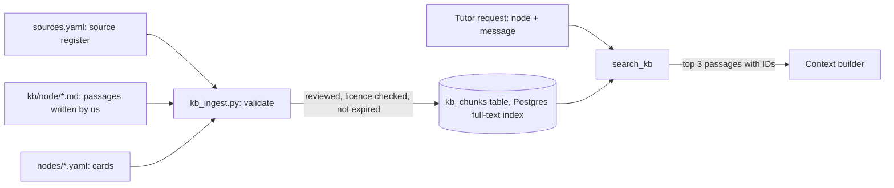
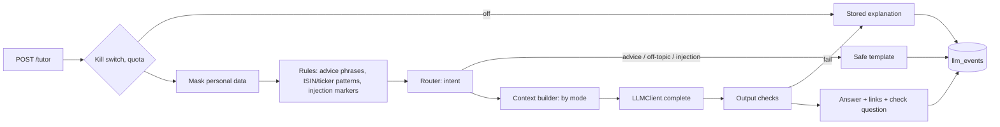

# Tutor agent: knowledge base, modular model, tutoring rules, who does what

Readers:
- Mateusz (ML, owner of the tutor);
- Mohamed (backend);
- Michał (frontend);
- anyone reviewing safety.

Purpose: enough detail to build the tutor in the 48 hours without
re-deciding the design.

Status: draft on branch `skills-tree`, 2026-11-20. It replaces the
architecture text that was in `backend/ml/README.md`. Wired behind `POST
/tutor` on 2026-11-21, switched by `TUTOR_PIPELINE` (section 5, "As
wired").

## Assumptions

1. **Stack.** The backend is FastAPI and PostgreSQL (backend README). The
   tutor is a Python package inside it, `backend/ml/tutor/`, not a separate
   service.
2. **Language.** The UI and the knowledge base are in English. Many sources
   are Polish, so knowledge-base passages are **our own English summaries**
   of a source, with a link to it. Facts and our own wording carry no
   licence problem. We quote the source only briefly, when the exact words
   matter.
3. **One model call per message.** The backend fetches everything the model
   needs before the call. There is no agent loop, and the model does not
   choose tools.
4. **Safety is enforced in code first.** What the model never receives, it
   cannot leak. The prompt is the second layer.

## 1. The tutor's job

| Mode | When | What the tutor may use | What it must not do |
|---|---|---|---|
| `explain_concept` | Any card or task, any time | Card text, knowledge-base passages | Give a task's answer |
| `hint` (levels 1-3) | Medium or hard task, before submission | Task text, the user's draft response, passages | See or reveal the true value, the box weights or the reference program |
| `explain_result` | After submission | Above plus the reveal JSON (truth, box explanations, the failing test's story) | Invent numbers that are not in the reveal |
| `rephrase` | User taps "Explain more simply" | The last tutor answer or card | Add new facts |
| `recommend_reading` | Struggle flag from the recommender, or user asks | Passages and links for the node | Recommend products, firms or advisers |

**Hint ladder.**
- Each hint is recorded in `hints_used`.
- The first two hints on a task are free.
- Every further hint lowers that task's score by 10% (a proposal).
- The task's start screen says so.
1. **Concept:** which idea the task is about, ending with a question back
   to the user.
2. **Worked example with other numbers:** the same calculation on a
   different case. It never uses the task's own numbers.
3. **Pointer:** which piece of information on screen matters, and why. It
   never names the answer or a box.

Every answer ends with one check question. In `hint` mode the tutor asks the
user to predict before it explains. That is the guided pattern the evidence
supports (Bastani et al. 2025, *PNAS*; Kestin, Miller et al. 2025,
*Scientific Reports*; read both before quoting numbers).

## 2. Connecting the knowledge base



**Files (authored by people, in Git).**
- `backend/content/sources.yaml`: one entry per source, with the fields
  `id, title, publisher, url, tier, licence, licence_checked_by,
  retrieved`.
- `backend/content/kb/<node>/<chunk_id>.md`: a passage of 50-150 words,
  with front matter:

  ```yaml
  ---
  id: s1.k2
  nodes: [S1]                 # may list more than one node
  source: bfg_guarantee       # ID in sources.yaml
  url: https://www.bfg.pl/gwarantowanie-depozytow/
  valid_until: 2026-12-31     # required if the passage has a limit, rate or tax rule
  reviewed_by: <name>
  ---
  Deposits in Polish banks are guaranteed by the Bank Guarantee Fund (BFG)
  up to the equivalent of EUR 100,000 per person per bank ...
  ```

- **Cards** from `backend/content/nodes/*.yaml` are ingested as passages
  too, because they are written and reviewed by people.

**Ingestion** (`backend/ml/tutor/kb_ingest.py`, run in CI and on deploy):
1. Reject a passage when any of these holds:
   - no reviewer;
   - its source is not in the register;
   - the source's licence is not confirmed;
   - `valid_until` has passed;
   - it is longer than 150 words.
2. Upsert the remaining passages into `kb_chunks`.

**Table** (Mohamed creates it, Mateusz fills it):

```sql
create table kb_chunks (
  chunk_id text primary key,
  node_ids text[] not null,
  source_id text not null,
  url text not null,
  body text not null,
  valid_until date,
  reviewed_by text not null,
  content_version int not null,
  tsv tsvector generated always as (to_tsvector('english', body)) stored
);
create index kb_chunks_tsv on kb_chunks using gin (tsv);
create index kb_chunks_nodes on kb_chunks using gin (node_ids);
```

**Retrieval:** `search_kb(node, query, k=3)`.
1. Passages tagged with the node, ranked by `ts_rank` against the query.
2. If there are fewer than k, add passages of the node's prerequisite nodes.
3. Never passages from unrelated panels, so that answers stay on the
   screen's topic.

This is Postgres full-text search: deterministic, no extra service, and
enough for a few hundred passages. Embeddings (pgvector) come later, only if
logged queries show that relevant passages are missed.

**Citations.**
- Passages go into the prompt as `[K1] ... [K2] ...`, and the model must
  cite them by those labels.
- The output check rejects a label that was not provided.
- The app turns the labels into source links.
- Source text itself is never in the prompt, only our own passages. A
  passage may state facts from any source in `sources.yaml` whose licence
  field is not `to_check`. Tier only decides whether a short verbatim quote
  is allowed (tier A).

## 3. A modular model

**One interface.** The tutor code never names a model.

```python
class LLMClient(Protocol):
    def complete(self, role: str, messages: list[dict], json_schema: dict | None,
                 max_tokens: int, contains_user_data: bool) -> Completion: ...

@dataclass
class Completion:
    text: str
    model: str
    tokens_in: int
    tokens_out: int
    latency_ms: int
```

**Roles, not models.**
- `router`: intent classification, short JSON output.
- `tutor_small`: default answers.
- `tutor_cloud`: optional. Only for requests with `contains_user_data =
  False`, for example a general concept question with no profile in the
  context.

**Configuration** (`backend/ml/config/llm.yaml`, chosen by the `LLM_CONFIG`
environment variable). The implementation uses the LiteLLM SDK. Check the
key names against the LiteLLM docs.

```yaml
roles:
  router:
    primary: {model: "ollama/<local model tag>", api_base: "${OLLAMA_API_BASE}", temperature: 0}
  tutor_small:
    primary: {model: "ollama/<local model tag>", api_base: "${OLLAMA_API_BASE}", temperature: 0.3}
    fallback: stored_explanation          # never a cloud model when user data is present
  tutor_cloud:
    primary: {model: "vertex_ai/<model>", vertex_location: "${VERTEX_AI_REGION}"}
    allowed_for_user_data: false
prompt_version: tutor-v1
```

**Rules.**
1. **Changing a model is a config change**, not a code change. The adapter
   refuses a call when `contains_user_data` is true and the role is not
   allowed user data.
2. **Prompts are files:** `backend/ml/prompts/<role>/<version>.md`,
   selected by `prompt_version`. Every `llm_events` row records the model
   and the prompt version.
3. **JSON output.**
   - The tutor answers in JSON:
     `{"text": ..., "cited": ["K1"], "check_question": ...}`.
   - Use the provider's JSON mode where it exists.
   - Retry once on invalid JSON, then show the stored explanation.
4. **Stored explanations** are the fallback for every failure: timeout,
   invalid JSON, a failed output check, the kill switch, or the quota.
   These are the `why` texts and editorials written by people.
5. **Choosing the model is a measurement.**
   - 20 English prompts from the demo tasks (`backend/ml/eval/prompts.yaml`).
   - Record:
     - tokens per second;
     - time to first token;
     - output-check pass rate;
     - a 1-5 rating from two people.
   - Pick the smallest model that passes the checks on at least 18 of 20
     and answers within about 10 s.
   - Candidates to measure: Qwen3.5 4B / 9B, Gemma 4 12B. Bielik becomes
     relevant for the later Polish version.

**Hosting.**
- Cloud Run has no free GPU.
- For the demo, the model runs on the fastest team laptop through Ollama,
  and the backend reaches it through `OLLAMA_API_BASE`.
- Answers for the scripted demo steps are generated in advance and stored,
  so a slow or offline model cannot stall the pitch.

## 4. Keeping it a tutor: the pipeline and its checks



**Context by mode.** This is the main guard, and it is enforced in code.

| Field | explain_concept | hint | explain_result | rephrase | recommend_reading |
|---|---|---|---|---|---|
| Card / task text | yes | yes | yes | – | – |
| User's draft response | – | yes | yes | – | – |
| Truth, box weights, reference program | **never** | **never** | from the reveal JSON only | – | – |
| Reveal JSON | – | – | yes | – | – |
| Profile aggregates (age band, goal, horizon, mastery, calibration gap) | yes | yes | yes | – | yes |
| Passages (top 3) | yes | yes | yes | – | yes (links) |
| Raw income, name, free-text history beyond 8 turns | never | never | never | never | never |

**System prompt (outline of `prompts/tutor_small/tutor-v1.md`).**
- **Role:** a patient tutor in a financial-literacy app for adults of all
  ages.
- **Use only** the facts and numbers in CONTEXT. If something is not there,
  say you do not know and point to the sources.
- **Never:**
  - recommend a product, fund, stock, bank or adviser;
  - say what to buy or sell;
  - give the answer to a task before it is submitted.
- **Hint levels:** 1 concept, 2 example with other numbers, 3 pointer.
- **Style:**
  - plain English, short sentences, at most 200 words;
  - explain each term the first time it appears;
  - cite passages as [K1];
  - end with one check question.
- **Output:** the JSON schema.

**Output checks** (each a pure function with tests; any failure → stored
explanation):
1. **Numbers.**
   - Every number in `text` (normalised: thousands separators, %, PLN) must
     appear in the context, within rounding.
   - Integers from 1 to 10 are allowed, because they appear in text like
     "two reasons".
2. **Advice.** No ISIN pattern, no ticker pattern, no names from the
   product and brand denylist. No imperative buy/sell phrasing ("you should
   buy", "sell your").
3. **No leak before submission.** No truth value, no box ID and no box text
   marked as correct may appear in `hint` or `explain_concept`.
4. **Citations.** Every cited label was provided, and at least one is cited
   when passages were provided.
5. **Form.** At most about 200 words and a non-empty `check_question`.

**Router intents:**
- `explain_concept`;
- `explain_task`;
- `hint`;
- `explain_result`;
- `recommend_reading`;
- `advice_request`: the safe template explains how to compare products
  yourself and points to node O2;
- `off_topic`;
- `injection`.

First version: rules, then `router` with a JSON schema at temperature 0.

## 5. API and data contracts

**`POST /tutor`.**

Request:

```json
{"mode": "hint", "screen_id": "task", "task_id": "i2.m1", "attempt_id": null,
 "draft_response": {"choice": "inflation_bond"}, "message": "Why would inflation matter here?"}
```

Response:

```json
{"text": "...", "links": [{"label": "K1", "url": "https://..."}], "check_question": "...",
 "hint_level": 1, "fallback": false}
```

**Boundary between the backend and the ML package.**

```python
# backend/ml/tutor/__init__.py (Mateusz)
def answer(req: TutorRequest, ctx: ContextProvider, llm: LLMClient) -> TutorResponse: ...

# implemented by the backend (Mohamed)
class ContextProvider(Protocol):
    def task_public(self, task_id: str) -> dict: ...         # no truth, no weights
    def reveal(self, attempt_id: str) -> dict | None: ...     # None before submission
    def profile_aggregates(self, user_id: str) -> dict: ...
    def task_secrets(self, task_id: str) -> dict: ...         # truth values and correct box texts, for the leak check only
    def search_kb(self, node: str, query: str, k: int) -> list[dict]: ...  # tutor.kb.SEARCH_SQL, run on Mohamed's connection
    def stored_explanation(self, key: str, mode: str) -> str: ...  # key: task_id, or the node for card screens
```

**`llm_events` row** (no raw text, except masked text of flagged answers,
kept for 30 days):

```
event_id, ts, user_pseudo_id, screen_id, task_id, node, mode, intent,
model_role, model, prompt_version, latency_ms, tokens_in, tokens_out,
checks_failed, fallback_used, hint_level, user_rating, flagged_for_review
```

**As wired (2026-11-21, `backend/app/tutor_pipeline.py`).** Mohamed's
`app/tutor_api.py` keeps the HTTP contract, the Ollama call (`call_model`),
Mermaid checking, titles and diagram repair. With `TUTOR_PIPELINE=true`, the
modes `explain_concept`, `hint`, `explain_result` and `rephrase` go through
`answer()` instead.
- **Model:** an `OllamaClient` wraps `call_model`; LiteLLM is not needed on
  the server.
- **Context:** a `DbContext` reads the engine catalog, the user's own
  attempts and onboarding, and the card passages. The app's context is used
  only for `node` and `task_id`.
- **Mode decided by the server:** with a stored attempt for the task, the
  request is served as `explain_result`, with the reveal. Without one it is
  `explain_concept`, whatever mode the app sends.
- **History and diagrams:** the last 8 turns go to the model, masked. A
  request for a chart adds the Mermaid skill, and the reply's `mermaid` field
  goes through `clean_mermaid`.
- **Reply:**
  - `[K1]` markers are removed from the text and the check question is
    appended;
  - `links`, `check_question`, `hint_level` and `hint_paid` are extra fields
    the app may ignore.
- **`/tutor/stream`:** the checks need the whole answer, so the stream sends
  one `delta` and the `done` line. It is the same NDJSON contract, without
  word-by-word streaming.
- **Fallback:** the stored explanation is a card's text, except in
  `explain_result`, so a failed hint never shows the answer.
- **Default off:** `TUTOR_PIPELINE` is off by default, so merging changes
  nothing until a test environment turns it on.
- **Not verified with Gemma yet:** whether it returns `cited` and
  `check_question` reliably. If it does not, most replies fall back. This
  shows in `/admin/llm-events` as `checks_failed`.

**Kill switches** (environment, readable from the admin panel):
- `TUTOR_ENABLED`;
- `TUTOR_PIPELINE` (our pipeline behind `/tutor`, default off);
- `CLOUD_ROLES_ENABLED`;
- `MODEL_ALLOWLIST`;
- `PROMPT_VERSION`;
- `DAILY_BUDGET`, which trips automatically;
- `USER_BLOCK`.

## 6. Admin panel: what goes from the logs to each view

The panel monitors the tutor and the recommender (router), as the frozen
plan asks.
- It reads two event tables: `llm_events` (above) and `reco_events`
  (below).
- It shows pseudonymous user IDs only.
- Access is limited to the admin role. Every kill-switch change is written
  to `admin_audit`.

**`reco_events` row**, one per router or recommender event:

```
event_id, ts, user_pseudo_id, router_version, event_type, node,
predicted_m, observed, need, overconfidence_term, interest_term,
priority, reason_term, path (for path_issued)
```

The `event_type` values are:
- `path_issued`;
- `recommendation_shown`;
- `recommendation_accepted`;
- `test_out`, with `observed` 1/0;
- `first_item`, with `observed` 1/0;
- `struggle_flag`;
- `tutor_nudge_shown`.

**When an answer is flagged for review** (`flagged_for_review = true`, and
the masked question and answer are kept for 30 days):
- any output check failed;
- intent `advice_request` or `injection`;
- the user rated it thumbs down;
- a random 2% of all other answers, to catch what the checks miss.

| View | Shows | From | Alert | Action |
|---|---|---|---|---|
| **Advice watch** | Advice requests and injections per day; output-check failures by type (numbers, advice, leak, citation, form); the nodes where they happen | `llm_events`: intent, checks_failed, node | More than 5% of answers in an hour fail the advice or leak check | Open the flagged queue; switch to stored explanations (`TUTOR_ENABLED=false`) |
| **Flagged queue** | Masked question and answer, flags, mode, model, prompt version | `llm_events` and the masked text | Queue older than 24 h | A reviewer labels it: ok / advice leak / wrong number / answer leak / other. Labelled failures are added to the red-team set |
| **Quality and cost** | Fallback rate; latency p50/p95; tokens and cost per day; thumbs up/down by mode; comparison between prompt versions | `llm_events` | p95 above 10 s; daily budget at 80% | Change `PROMPT_VERSION` or `MODEL_ALLOWLIST` |
| **Hints and learning** (descriptive, not causal) | Hint use per task (free vs paid); score and confidence on attempts with and without a tutor session, per node | `llm_events` and attempts | A task where most users need the paid hint | Send it to the content author |
| **Recommender** | Router forecast against reality: mean predicted m vs observed first-item success, by decile and by node; test-out pass rate; first paths issued; recommendations accepted vs ignored; struggle flags per node | `reco_events` | A node where the predicted m is off by more than 0.2 from observed success over 30+ users | Adjust that node's difficulty, or the need rules (bump `router_version`) |
| **Population drift** | The survey answers of our users against the EB525 Polish shares (Q1, Q8, knowledge items) | survey table | — | Context for reading the other views |
| **Switches** | Current kill-switch state, who changed it and when | env and `admin_audit` | — | Toggle (admin only) |

## 7. Tests

Each test has a reason:

| Test | Why |
|---|---|
| Each output check: one hand-written passing text, one failing text | The checks are the safety layer; a regex change can silently open it |
| Context builder: in `hint` mode the context contains no truth, weights or reference program for a task that has them | This is the structural guard against answer leaks |
| `kb_ingest`: rejects an unreviewed, expired and unknown-source passage | Unreviewed text must never reach the model |
| Adapter: refuses `contains_user_data=True` on a role not allowed user data | Privacy rule |
| Red-team set: about 50 English and Polish prompts (advice extraction, "just tell me the answer", injection), run against rules and router | Expected: safe template or hint, never the answer. Run in CI on rules; on the model when the model or prompt changes |
| Model choice set: 20 prompts | Run by hand when the model or prompt changes, not in CI |

## 8. Who does what

| Piece | Mateusz (ML) | Mohamed (backend) | Others |
|---|---|---|---|
| `POST /tutor` endpoint, auth, quota counter, rate limit | | builds | |
| `ContextProvider` (DB reads: task without answers, reveal, profile aggregates) | defines the interface | implements | |
| Tables and migrations: `kb_chunks`, `llm_events`, `reco_events`, `admin_audit` | specifies columns | creates | |
| `kb_ingest.py`, `search_kb` SQL | builds | runs in deploy/CI | |
| Knowledge-base passages and `sources.yaml` | template, reviews | | content authors write; second person reviews |
| `LLMClient` adapter, `llm.yaml`, LiteLLM | builds | provides env vars and secrets | |
| Prompts, router intents, hint ladder, output checks | builds | | |
| Stored explanations as fallback | | serves them | content authors (`why`, editorials) |
| Model measurement and choice; Ollama on the demo laptop | runs | network access from the backend | |
| Red-team and check tests | builds | CI job | |
| Kill switches | reads them in the pipeline | env and admin endpoint | |
| Admin panel (section 6): seven views | specifies the views, alerts and the recommender metrics; writes `reco_events` from the router | API (`GET /admin/llm-events`, `GET /admin/reco-events`, `GET /admin/flagged`, `POST /admin/flagged/{id}/label`, `POST /admin/switches`) | Michał: UI |
| Tutor bubble: modes, hint buttons, "Explain more simply", links, thumbs | | | Michał |
| Pre-generated answers for the demo script | generates and reviews | stores | |

**Order for the 48 hours.**
1. **Friday evening.**
   - Mateusz: `LLMClient` with a fake model, the `answer()` skeleton, the
     output checks with their tests.
   - Mohamed: `POST /tutor` returning stored explanations end to end, and
     the tables.
2. **Saturday morning.**
   - `kb_ingest` and `search_kb` on the passages for S1, I1, I2.
   - Context builder by mode.
   - First prompt version.
3. **Saturday afternoon.**
   - Model measurement on the demo laptop, then the choice.
   - Red-team run.
   - Admin advice-watch view.
4. **Sunday morning.**
   - Freeze `prompt_version`.
   - Pre-generate and review the demo answers.
   - Kill-switch drill: turn the tutor off and check the app still works.
